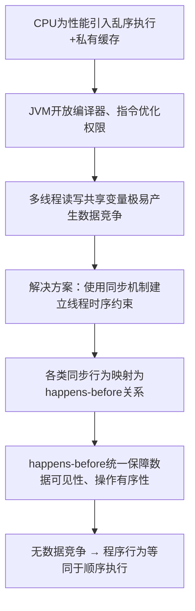

# Java 并发核心：为什么需要 happens-before？
很多人在学习 Java 并发的时候，会直接开始背诵知识点：
- `volatile` 保证可见性
- `synchronized` 保证线程安全
- `Lock` 可以手动加锁
- happens-before 存在八条规则

但绝大多数人都没有弄懂底层根源问题：
1. 为什么会诞生 happens-before 这套机制？
2. 为什么恰好是这八条规则，而非十条、二十条？
3. happens-before 从本质上解决了计算机并发中的什么痛点？

本文站在设计者视角，逐层拆解 Java 内存模型（JMM）中 happens-before 的设计初衷与底层原理。

## 一、无性能优化的理想环境：根本不需要 happens-before
假设计算机运行环境满足以下理想化条件：
1. CPU 严格依照代码书写顺序串行执行指令
2. 不存在 CPU 多级缓存
3. 编译器不会做任何代码优化
4. 全程没有指令重排行为
5. 所有线程直接读写同一份主内存数据

此时多线程交互逻辑十分简单：
- 线程A：修改共享变量
- 线程B：读取该共享变量

线程B**一定可以读取到线程A修改后的最新值**，整个程序拥有天然的全局时序，所有操作的先后顺序清晰可追溯。
> 结论：理想化串行环境下，天然具备有序性与可见性，happens-before 没有存在的必要。

## 二、真实物理环境：为了性能，引入了三层破坏顺序的优化
现代计算机体系为压榨硬件执行效率，设计了大量性能优化方案，也是并发乱象的源头，主要分为三类。

### 1. CPU 指令重排
CPU 依靠流水线机制提升运行效率，若死板等待上一条指令执行完毕再执行下一条，会造成大量硬件空闲损耗。
CPU 会在**单线程运行结果不变**的前提下，自由调换指令执行顺序。

示例代码：
```java
int a = 1;
int b = 2;
```
CPU 实际执行顺序可能变为：
```java
b = 2;
a = 1;
```
单线程运行结果无任何差异，CPU 的重排行为是被硬件允许的合法优化。

### 2. CPU 多级缓存结构
每个CPU核心独占独立的高速缓存：L1 Cache、L2 Cache，多个核心共享L3缓存。
线程修改变量时，数据只会先写入当前核心的私有缓存，不会立刻同步刷新到主内存。
最终现象：线程A修改了缓存数据，线程B读取主内存只能拿到旧数据，产生数据可见性问题。

### 3. JIT 编译器优化
Java 运行期JIT编译器同样会对字节码做优化处理：
- 指令重排序
- 剔除无效冗余代码
- 将变量缓存至寄存器减少内存访问

编译器只保障**单线程执行逻辑正确**，无法感知多线程之间的数据依赖关系，多线程场景下优化行为会打乱数据时序。

## 三、优化带来的恶果：多线程行为不可推理（经典案例）
```java
int a = 0;
boolean flag = false;

// 线程A执行逻辑
a = 1;
flag = true;

// 线程B执行逻辑
if(flag){
    System.out.println(a);
}
```
按照常规思维：只要`flag = true`成立，变量`a`的值一定等于1。
但真实运行环境中，程序**大概率会打印出 0**，成因分为三点：
1. CPU/JIT发生指令重排，线程A实际执行顺序变为 `flag=true → a=1`
2. 线程A的修改仅存于CPU私有缓存，未同步到主内存，线程B读取旧缓存数据
3. 线程B抢先读取到未更新的原始内存数据

> 重要说明：该现象不属于JVM Bug，是硬件、编译器性能优化带来的必然副作用。

## 四、JVM 的折中方案：JMM + happens-before
全盘禁用所有软硬件优化，会造成程序性能断崖式下跌；完全放任无限制优化，开发者无法预判多线程代码运行行为。

JVM需要在**运行性能**与**并发正确性**之间做平衡，解决方案就是 **Java内存模型（JMM）**。
而 **happens-before**，就是JMM交付给开发者、用来约束多线程时序与可见性的标准规则体系。

## 五、纠正误区：happens-before 不是「代码物理执行先后」
大众普遍错误理解：`A happens-before B` = A代码物理时间上一定先执行、B后执行。

### 真实定义
happens-before 描述的是**数据可见性与操作因果关系**，而非真实的CPU执行时序：
> 若 A happens-before B，JVM强制保证：B一定能观测到A执行完成后的所有数据修改，A的操作结果会对B产生有效影响。

以volatile读写举例：
```java
// volatile写
flag = true;
// volatile读
if(flag)
```
并不是CPU必须先执行写操作、再执行读操作；真实含义为：线程一旦读取到`flag=true`这个volatile标记，写操作之前所有变量的修改，必须对当前读线程全部可见。

## 六、happens-before 为什么刚好是八条规则？
规则数量并不是官方凭空指定为8条，本质是：**Java语言中所有合法的线程同步、通信方式，对应一条happens-before约束**，八条规则是对全部同步行为的标准化数学描述。

八条完整规则明细：
1. **程序次序规则**：同一个线程内，书写在前的操作 happens-before 书写在后的操作。
2. **监视器锁规则**：同一个锁，锁的释放操作 happens-before 后续该锁的获取操作。
3. **volatile变量规则**：volatile字段的写入操作 happens-before 后续对该字段的读取操作。
4. **线程启动规则**：`Thread.start()`方法调用之前的所有代码，happens-before 新启动线程内部的任意操作。
5. **线程终止规则**：线程内部所有执行操作，happens-before 其他线程执行`join()`方法并正常返回。
6. **线程中断规则**：调用`interrupt()`发起中断的操作，happens-before 被中断线程检测到中断标识的操作。
7. **final字段规则**：对象构造方法完成初始化后，final修饰字段的值对其他访问线程永久可见，实现对象安全发布。
8. **传递性规则**：若A happens-before B，B happens-before C，则推导得出 A happens-before C。

## 七、传递性：happens-before体系的核心压缩机制
如果没有传递性规则，系统需要为每两段存在先后关系的操作单独定义约束，规则数量会无限膨胀。

举例链路：A修改数据 → B释放锁 → C获取锁
依靠传递性，自动建立 A→B→C 的happens-before关系，A的数据修改天然对C可见；无需单独定义A与C的绑定规则。
> 传递性是整个happens-before体系的精简压缩核心，用最少规则覆盖全部时序链路。

## 八、happens-before 的设计目标：构建最小完备系统
JMM设计happens-before时锁定三大核心目标：
1. **完备性**：全覆盖Java所有线程同步场景，不存在遗漏的同步关系
2. **简洁性**：控制规则数量，降低开发者学习与使用成本
3. **兼容性**：最大限度放行CPU、编译器的各类优化，不牺牲程序运行性能

本质：happens-before 是一套**最小且自洽的多线程行为推理系统**。

## 九、并发问题的根源不是重排/缓存，而是数据竞争
指令重排、多级缓存、编译器优化只是并发异常的外在表现，真正的元凶是**数据竞争（Data Race）**。

### 数据竞争判定三要素（同时满足即产生数据竞争）
1. 多个线程访问同一个共享变量
2. 至少有一个线程对变量执行写入操作
3. 读写线程之间不存在任何happens-before约束

示例（无同步自增）：
```java
int count = 0;
// 线程A
count++;
// 线程B
count++;
```
无锁、无volatile、无任何同步措施，两条自增操作无因果绑定，程序最终结果不可预测。

## 十、JMM 核心保障原则：DRF-SC
DRF-SC 全称：`Data Race Free → Sequential Consistency`
翻译：**无数据竞争的程序，执行效果等价于顺序一致性执行**。

通俗解释：开发者正确使用同步机制、依靠happens-before消除数据竞争后，多线程代码的运行逻辑和单线程代码一样具备稳定、可预期的执行结果。
反之：代码存在数据竞争时，JVM不会对程序运行行为做任何承诺，运行结果随机不可控。

## 十一、Java 并发知识整体链路梳理


## 十二、全文总结
一句话概括happens-before的诞生意义：
> 现代硬件为性能打破了原始的串行执行模型，happens-before是Java设计的一套折中数学模型：既允许软硬件正常优化保障性能，又给开发者提供了可推理、可管控的多线程并发边界。

CPU重排、缓存不一致、编译器优化都不是并发Bug的本源问题，**线程之间是否通过同步机制建立合法的happens-before因果关系**，才是解决并发安全的核心关键。
happens-before就是Java体系中，定义线程数据因果关系的标准数学模型。
